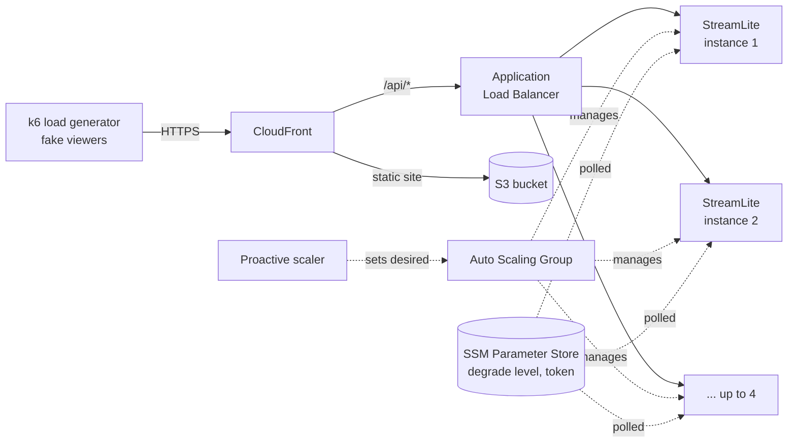
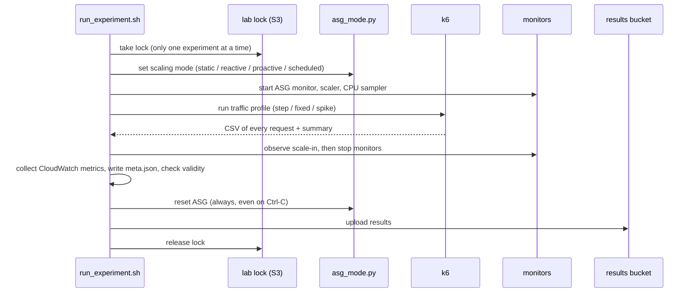
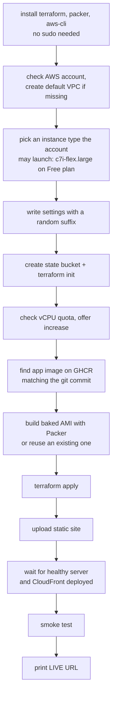

# Hotstar Scale Lab: how we built it

This report explains what the project does, how each part was built, how the parts connect, and
what is still left. It covers everything up to 16 Nov 2026.

---

## 1. The problem we are copying

During an IPL or World Cup match, Disney+ Hotstar gets a sudden wall of traffic. Millions of people
open the app within a minute or two when a key moment happens (toss, last over, a wicket). New
servers take several minutes to boot, but the spike arrives in about 90 seconds. If you only add
servers *after* CPU goes up (reactive scaling), you are already too late.

Hotstar's real answer has three parts:
1. **Scale before the spike** (proactive / pre-warmed capacity), using the expected audience.
2. **Boot faster** (pre-built machine images instead of installing at boot).
3. **Degrade gracefully** (switch off non-essential features such as recommendations so the
   essential ones, like playback, keep working).

Our project is a **small, honest replica** of that problem on AWS. We cannot create millions of users,
so we scale everything down: one server handles about 100 requests per second instead of thousands,
at most 4 servers run at once, and our "spike" goes from 30 to 280 requests per second. The *shape* of the problem stays the same:
the traffic rises faster than new servers can boot.



---

## 2. How the work is organised

| Phase | What | Where | Status |
|---|---|---|---|
| 0 | Repo skeleton, tool checks, backlog, plans | root, `scripts/`, `docs/` | done, pushed |
| 1 | StreamLite app, tests, container, CI | `app/`, `.github/` | done, pushed |
| 2 | AWS infrastructure (Terraform + Packer) | `infra/` | code done, pushed; not deployed yet |
| 3 | Load tests, scaling modes, experiment runner | `harness/` | done locally, **not committed** |
| – | One-command deploy | `deploy_aws.sh` | done locally, not committed |
| – | Fit the AWS Free plan (USD 118 credit) | `infra/`, `harness/`, `deploy_aws.sh` | done locally, not committed (section 9) |
| 4 | Running the experiments on AWS | – | waiting for AWS |
| 5 | Analysis, plots, cost model | `analysis/` | not started |
| 6–7 | Dashboard, report, viva | `web/`, `docs/report/` | not started |

Planning documents written first:
- `docs/IMPLEMENTATION_PLAN_DETAILED.md`: the detailed plan, built from the original PDF. It also
  fixes problems found in the original plan (the "F" numbers, such as F1 or F16, that appear below).
- `docs/TEAM_PLAN_3_PEOPLE.md`: who does what and in which order, for three people:
  - **A**: infrastructure;
  - **B**: app, dashboard and analysis;
  - **C**: load lab and experiments.

The guiding rule was: **everything that can be tested without AWS is tested without AWS.** Every
phase has offline checks (unit tests, Terraform tests against a fake AWS, local dry runs), so the
paid AWS time is spent only on the real experiments.

---

## 3. Phase 0: setup

What we built:
- **Repo skeleton**: folders, `.gitignore`, licence, CODEOWNERS, a PR template.
- **`make doctor`** (`scripts/doctor.sh`): checks that python, docker, terraform, packer, k6 and the
  AWS CLI are installed, so every teammate starts from the same tools.
- **Split Makefile**: one fragment per owner (`make/infra.mk`, `app.mk`, `lab.mk`, `analysis.mk`), so
  three people can edit "the Makefile" without merge conflicts.
- **Backlog** (`docs/backlog.tsv`) and `scripts/create_issues.sh`, which turns every task into a
  GitHub issue.
- **Sources log** (`docs/sources.md`) for every claim the report makes about Hotstar, and a
  **runbook** and **progress log**.

---

## 4. Phase 1: StreamLite, the test application

We needed an app that behaves like a streaming backend under load, but whose cost per request is
**predictable**. Otherwise you cannot say "one server handles 100 requests per second".

### 4.1 Endpoints

| Endpoint | Type | CPU cost | Why it exists |
|---|---|---|---|
| `POST /api/v1/playback/start` | critical | 15 ms | a viewer pressing play |
| `POST /api/v1/heartbeat` | critical | 2 ms | the player pinging every few seconds |
| `GET /api/v1/match/state` | public, cacheable | 1 ms | the live score; CloudFront can cache it for 5 s |
| `GET /api/v1/recommendations` | non-critical | 40 ms | the first thing to switch off under load |
| `GET /healthz`, `/api/v1/whoami` | infra | ~0 | health checks, which instance answered |
| `GET /internal/stats` | internal | ~0 | requests per second, in-flight, p95; blocked at the ALB |

### 4.2 Key design decisions

- **Fake CPU work with PBKDF2** (`app/work.py`). Each request runs a password-hash function a fixed
  number of times.
  - It does exactly the same amount of work every time.
  - It runs outside Python's GIL, so two threads really use both CPU cores.
  - A simple "sleep" or "spin for N ms" would hide overload. When the CPU is busy, a timed loop just
    does *less* work.
  - `WORK_SCALE` tunes the cost so that one c7i-flex.large saturates near 100 rps.
- **Counting arrivals, not completions** (`app/stats.py`). The scaler needs to know how much traffic
  is *coming in*, not how much the overloaded server managed to finish. A saturated server finishes
  fewer requests, which would make a completion-based scaler think the load went *down*.
- **Graceful degradation** (`app/degrade.py`). Every instance polls an SSM parameter
  `degrade_level` every few seconds. At level 1, recommendations return an empty list instantly.
  There is also an **auto-shed** mode: an instance sheds recommendations by itself when too many
  requests are in flight.
- **Rate limiting with a load-test bypass** (`app/ratelimit.py`). The public site has a per-client
  limit. Our load generator sends a secret token (stored in SSM as a SecureString), so the
  experiments are not throttled. Any HTTP 429 during an experiment means the run is invalid.
- **Configuration only through environment variables** (`app/config.py`), so the same container
  image runs on a laptop, in Docker and on EC2.

### 4.3 Tests, container and CI

- **36 pytest tests** covering:
  - endpoints;
  - shedding;
  - rate limiting;
  - stats;
  - config.
- **Docker image** (`app/Dockerfile`).
- **GitHub Actions** (`.github/workflows/ci.yml`): lint, run the tests, build the image and push it
  to GHCR (`ghcr.io/yug1707/streamlite`), tagged with the git commit (for example `86c00d4`).
- **`scripts/calibrate.py`**: measures how fast PBKDF2 runs on a machine, so the CPU costs can be
  re-tuned on the real c7i-flex.large.

---

## 5. Phase 2: the AWS infrastructure (`infra/`)

The whole of Phase 2 lives in one folder, `infra/`. It is written as code, so the whole stack can
be created and destroyed with one command, and nobody clicks around the AWS console.

### 5.1 What gets created (region ap-south-1, Mumbai)

| File | Creates |
|---|---|
| `network.tf` | security groups (no SSH port 22; access is through SSM Session Manager) |
| `iam.tf` | roles: app instances may read `/streamlite/*` parameters; the loadgen may drive the ASG and write results |
| `ssm.tf` | `degrade_level` parameter and the load-test token (random, SecureString) |
| `alb.tf` | the load balancer, plus a rule that returns 404 for `/internal/*` so stats are never public (F2) |
| `asg.tf` | launch template (IMDSv2 required, F16) and the Auto Scaling Group: c7i-flex.large, max 4 |
| `site.tf`, `cloudfront.tf` | the static site in a private S3 bucket and the CloudFront HTTPS front door |
| `loadgen.tf` | a c7i-flex.large load-generator machine (only when switched on) and the results bucket |
| `budgets.tf` | a cost alarm emailed to the team; it counts usage *before* credits (section 9) |
| `outputs.tf` | names and URLs that the scripts need |

### 5.2 Decisions that matter for the experiments

- **Terraform does not fight the scaler (F1).** The ASG's `desired/min/max` sizes are in
  `ignore_changes`. Otherwise every `terraform apply` would undo what the experiment just set.
- **Two boot modes (F9)**, which experiment E5 compares:
  - **naive**: the instance boots plain Amazon Linux, installs Docker, pulls the image and starts.
    This is slow, like a real cold start.
  - **baked**: Packer (`streamlite.pkr.hcl`) pre-builds an AMI with Docker and the image already
    inside, so the instance only has to start the service. This is the "boot faster" lesson from
    Hotstar.
- **CloudFront caching rules.**
  - `/api/v1/match/*` is cached, because everyone wants the same score.
  - All other `/api/*` paths are not cached and are passed through to the ALB.
  - Experiment E7 measures how much load the cache removes from the servers.
- **State storage.** Terraform state lives in a versioned S3 bucket with S3-native locking
  (`use_lockfile`), so two teammates cannot apply at the same time.
- **Helper scripts.**
  - `smoke.sh` checks the live URL end to end: HTTPS works, `/internal` is blocked, caching works,
    and traffic spreads over instances.
  - `reset_asg.sh` removes every scaling policy and puts the ASG back to 1 instance.

### 5.3 How we tested it without AWS

- `terraform validate`, and **6 `terraform test` runs** against a *mock* AWS provider
  (`hsl.tftest.hcl`). They check, for example, that baked mode needs an AMI id, that the ASG max
  never exceeds 4, that the app uses the Free-plan type, and that `/internal/*` is blocked.
- `packer validate`, `shellcheck` on all scripts, and CI jobs for Terraform and Packer.
- One problem we hit: in the mock provider, AWS provider v6 leaves the IDs of CloudFront's managed
  cache policies empty. We replaced those lookups with the fixed, published AWS IDs, which work both
  in tests and in real AWS.

---

## 6. Phase 3: the load lab (`harness/`, not committed)

This is the part that runs experiments. It runs on the **loadgen** EC2 machine, inside AWS, so the
network between the test and the app is not the bottleneck.



### 6.1 Traffic generation: k6

| File | What it does |
|---|---|
| `lib.js` | the viewer mix: 55 % heartbeat, 10 % playback, 20 % match state, 15 % recommendations |
| `step.js` | rate climbs in 10 steps, used to find where one server breaks (E1) |
| `fixed.js` | constant rate, used for capacity and degradation tests |
| `spike.js` | the "match day" shape, in multiples of C1: 0.3 → 2.0 × C1 in 90 s, three "wicket" bursts of 2.8 × C1, then 0.5 × C1; 12.5 minutes. With C1 = 100: 30 → 200 rps, bursts of 280 |

We use k6's **open model** (`ramping-arrival-rate`). New requests arrive at the planned rate *whether
or not* the server keeps up, just like real viewers. In a closed model, a slow server would
automatically get fewer requests and look healthier than it is.

### 6.2 Scaling modes: `asg_mode.py`

- `static N`: a fixed number of servers.
- `reactive`: AWS target tracking on CPU. This is what most people do, and what we expect to be too
  slow.
- `proactive`: our own scaler (`proactive_scaler.py`).
- `scheduled AT N`: an AWS scheduled action that adds servers at a set time before the spike.
- `reset`: back to 1 instance, with all policies removed.

### 6.3 The proactive scaler (`proactive_scaler.py`)

This is the core idea of the project, in code. Every few seconds it:
1. Asks each instance how many requests are **arriving** (`/internal/stats`).
2. Computes `needed = ceil(rps × headroom ÷ C1)`. Here C1 is one server's capacity (about 100 rps)
   and headroom is 1.3. At the 2.8 × C1 burst that gives exactly 4 servers, the fleet cap.
3. Never goes below a **pre-warm floor**, for example 3 servers before a known match.
4. **Scales out immediately** but **scales in one step every 5 minutes**. Adding is cheap; removing
   too early is what hurts.
5. Handles missing answers. If some instances do not answer, it extrapolates from the ones that do.
   If no data arrives at all, it changes nothing.

### 6.4 Measuring and running

- `monitor_asg.py`: writes the ASG timeline, the instance list and per-instance stats.
- `collect_cw.py`: collects 14 CloudWatch metrics (ALB latency, 5xx, CPU, …).
- `sample_cpu.py`: watches the loadgen's own CPU. If the load generator is overloaded, the
  measurements are wrong.
- `run_experiment.sh`: one run from start to finish. A `trap` makes sure that even after an error
  or Ctrl-C it always resets the ASG, restores the degrade settings, uploads results and releases the
  lock.
- `lab_lock.py`: an S3 object created with a conditional write. If two people try to run at the same
  time, only one wins.
- `experiments.yaml` plus `exp.sh`: the experiment matrix in one file. `exp.sh E3 1` runs experiment
  E3, run 1.
- **Validity rule**: a run counts only if all of these hold:
  - no dropped requests;
  - no 429s;
  - loadgen CPU stays below 70 %;
  - k6 exits normally.

### 6.5 How we tested it without AWS

- **41 unit tests** with fake AWS clients. They cover the scaler decisions, the modes, the stability
  wait, the monitor, the config, CloudWatch collection and the lock.
- **ruff**, **shellcheck** and `k6 inspect` for all three profiles.
- **Full local dry run** (`make dry-local`): the real runner against the app on the laptop, with the
  spike sped up 10×. Result:
  - the run was valid, with 0 dropped requests and 0 rate-limit errors;
  - the scaler correctly decided to scale out when traffic hit 26.8 rps with C1 = 10.

---

## 7. The experiments (Phase 4, still to run)

| ID | Question | How |
|---|---|---|
| E1 | How much can **one** server take (C1)? | step load on 1 instance, 3 runs, take the median knee |
| E2a/b | Does capacity grow linearly with servers? | 1–4 instances, fixed and step load |
| E3 | Does **reactive** autoscaling survive a match spike? | spike profile, CPU target tracking |
| E4a–d | Does **proactive** / pre-warmed / scheduled scaling do better? | spike, different scaler settings |
| E5 | How much faster does a **baked** AMI boot than a naive one? | scale 1 → 4, time every boot stage |
| E6 | Does **graceful degradation** protect the critical endpoints? | overload 2 servers: none vs SSM level 1 vs auto-shed |
| E7 | How much does the **CloudFront cache** remove from the servers? | match-state traffic via ALB vs via CloudFront |

The expected story:
- **E3**: reactive scaling breaks the latency target during the spike.
- **E4**: proactive scaling holds the target, but costs more idle server time.
- **E5**: baked images shorten the gap.
- **E6, E7**: degradation and caching buy time while servers boot.

Phase 5 will put numbers and a cost model on this.

---

## 8. One-command deploy: `deploy_aws.sh`

So that nobody has to remember 15 commands, `deploy_aws.sh` does the whole deploy from a laptop or
from AWS CloudShell:



| Command | Does |
|---|---|
| `./deploy_aws.sh` | everything above |
| `./deploy_aws.sh lab` | starts the loadgen and uploads `harness/` |
| `./deploy_aws.sh lab-down` | resets the ASG and stops the loadgen (saves money) |
| `./deploy_aws.sh pause` | stops every server (ASG to 0); only the load balancer keeps costing |
| `./deploy_aws.sh resume` | starts 1 server again and waits until the URL works |
| `./deploy_aws.sh status` | shows what is running |
| `./deploy_aws.sh destroy` | deletes everything, AMIs and snapshots included |

It must be run **from inside the repo folder**, because it uses `infra/` and `harness/`.

---

## 9. Fitting the AWS Free plan (USD 118 credit)

### 9.1 What went wrong on the first real run

The first `./deploy_aws.sh` run on our AWS account got through the tools, the account check, the
Terraform state bucket and the vCPU quota request. It stopped at step 7, when Packer tried to start
its temporary build server:

```
InvalidParameterCombination: The specified instance type is not eligible for Free Tier
```

Our account is on the AWS **Free plan**: AWS gives a credit (USD 118 for us) instead of a bill, and
in exchange the account may only launch **free-tier-eligible instance types**. The design used
`c6i.large` (app, Packer) and `c6i.xlarge` (load generator), and neither is eligible. Nothing had
been created yet apart from the state bucket, so nothing had to be cleaned up.

### 9.2 What we changed

| Area | Before | After | Why |
|---|---|---|---|
| App server type | c6i.large | **c7i-flex.large** | eligible on the Free plan, same shape (2 vCPU, 4 GiB, x86_64), so the app, the AMI and the calibration method stay the same |
| Packer build server | c6i.large | c7i-flex.large | the build failed here first |
| Load generator | c6i.xlarge (4 vCPU) | c7i-flex.large (2 vCPU) | not eligible; 2 vCPU is enough for 280 rps, and the 70 % CPU validity check still guards it |
| Max app servers | 6 | **4** | 8 vCPU + 2 for the load generator fits a small quota and the credit |
| Spike profile | 0.3 → 3.0 × C1, bursts 4.2 × C1 | 0.3 → **2.0** × C1, bursts **2.8** × C1 | the peak must be servable by 4 servers, otherwise even perfect scaling fails |
| Scaler headroom | 1.6 | **1.3** | `ceil(2.8 × 1.3) = 4`, so the proactive scaler reaches exactly the cap at the peak |
| Pre-warm (E4c, E4d) | 4 servers | 3 servers | `ceil(2.0 × 1.3) = 3` covers the match level before the bursts |
| E2 sweep, E5 boot test | 1–5 servers | 1–4 servers | the new cap |
| Budget alarm | net cost | **gross usage** (`include_credit = false`) | with credits the net bill is always $0, so a normal budget would never warn us |
| Subnets for servers | all default subnets | only AZs that offer the instance type | not every AZ offers every type; avoids launch failures |
| Burstable fallback | – | t3 types get "unlimited" CPU credits | a throttled t3 would fake a capacity limit in the middle of an experiment |

`deploy_aws.sh` now picks the type by itself. It asks AWS which types this account may launch
(`describe-instance-types --filters free-tier-eligible=true`), prefers c7i-flex.large, then
m7i-flex.large, and writes the choice to `infra/instance.auto.tfvars`. Terraform and Packer both use
it. Setting `APP_TYPE=<type>` overrides the choice. On a paid account it simply uses c7i-flex.large.

The story of the experiments does not change. Every load level is a multiple of C1, the capacity of
one server, which E1 measures on the real instance type. The ratios stay the same:
- the traffic still grows faster than new servers can boot;
- one server is still overwhelmed by the match level, 2 × C1 within 90 s;
- the burst still needs the whole fleet.

### 9.3 One caveat: "flex" instances

c7i-flex instances are not burstable like t3, but AWS says they run at full speed only "most of the
time". There is a baseline below which they never drop. For long, fully saturated runs this could
lower capacity a little. We handle it in three ways:
1. E1 measures C1 on the same type, so every experiment is relative to the real capacity.
2. Our runs are short: 10–13 minutes each, with 5-minute cool-downs.
3. The report names it as a limitation.

### 9.4 Spending plan for the USD 118 credit

Approximate figures for ap-south-1. Check the AWS pricing pages for exact prices.

| Item | Rate | Estimate |
|---|---|---|
| Stack up (1 server + ALB + public IPs) | ≈ USD 3 / day | 10 working days ≈ USD 30 |
| Stack paused (`pause`: ALB + IPs only) | ≈ USD 1 / day | 15 days ≈ USD 15 |
| Lab sessions (load generator + up to 4 servers) | ≈ USD 0.5 / hour | 20 hours ≈ USD 10 |
| Packer builds, S3, CloudWatch, CloudFront, data transfer | – | ≈ USD 5 |
| **Total** | | **≈ USD 60**, about half the credit, leaving a safety margin |

Rules that keep us inside it:
- Run `./deploy_aws.sh pause` whenever nobody is using the stack.
- Run `lab-down` right after every lab session.
- Run `destroy` after the viva.
- The budget alarm (USD 25 a month, alerts at 50 %, 80 % and a 100 % forecast) emails the team
  before the credit is in danger.

### 9.5 Other problems on the first real runs

| Run | Problem | Cause | Fix |
|---|---|---|---|
| 2 | Packer: `IMAGE must be set` | our Packer template's `execute_command` dropped `{{ .Vars }}`, so the environment variable never reached the script | added `{{ .Vars }}`; tested in an Amazon Linux 2023 container; the AMI then built in 5 m 30 s |
| 3 | Auto Scaling: `Access denied when attempting to assume role ... AWSServiceRoleForAutoScaling` | on a new account AWS creates this role on first use, and it takes a moment before it can be used | `deploy_aws.sh` now creates the Auto Scaling and ELB service roles up front, waits, and retries `terraform apply` |
| 3 | CloudFront: `Your account must be verified before you can add new CloudFront resources` | new AWS accounts may not create CloudFront until AWS Support verifies them; code cannot fix this | CloudFront is now optional (`enable_cloudfront`). The script switches it off automatically, the stack runs with the load balancer as its URL, and `CLOUDFRONT=on ./deploy_aws.sh` adds CloudFront once AWS confirms |

Until CloudFront is enabled:
- The live URL is the load balancer's `http://` address, so there is no HTTPS.
- The API works.
- The dashboard page and experiment E7 (CloudFront caching) have to wait.
- Every other experiment talks to the load balancer directly, so it is not affected.

---

## 10. Safety rules we followed

- **No secrets in git.** AWS keys, `terraform.tfvars`, `.backend.hcl` and `.env.tf` are git-ignored.
  The load-test token is generated by Terraform and stored only in SSM.
- **No SSH.** Machines are reached through SSM Session Manager, so port 22 is never open.
- **Costs are capped.** At most 4 app instances, Free-plan instance types, a budget alarm on gross
  usage, a loadgen that runs only when switched on, `pause` between sessions, and `destroy` at the end.
- **One experiment at a time** (the lab lock), and the ASG is **always reset** after a run.
- **Invalid runs are kept and logged, never deleted**, so the results are honest.

---

## 11. What is left

1. **Rerun `./deploy_aws.sh`** with the latest changes (section 9.5). The AMI `ami-0e6a80cb34d3abb8f`
   is built and reused. Open an AWS Support case to get the account verified for CloudFront, then run
   `CLOUDFRONT=on ./deploy_aws.sh`.
2. **Commit Phase 3 and the Free-plan changes**:
   - `harness/`, `deploy_aws.sh` and this report;
   - the edits in `infra/`, `make/lab.mk`, `app/work.py` and `scripts/calibrate.py`.

   This lets teammates deploy and run experiments from a fresh clone.
3. **Calibrate on c7i-flex.large and run E1** to find the real C1, then run E2–E7 in lab sessions.
4. **Phase 5**: parse results, draw plots, build the cost model. This can be started now with fake
   data.
5. **Phase 6–7**: dashboard on the live URL, the final report and viva slides.
6. **`./deploy_aws.sh destroy`** when everything is finished.
